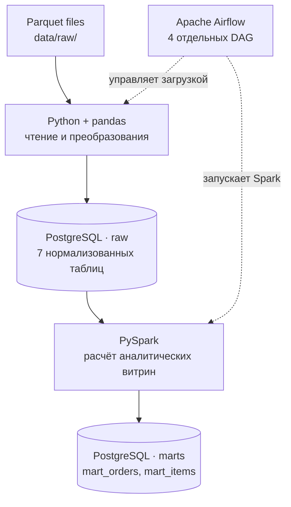

# Delivery Data Pipeline

**ETL-пайплайн для обработки данных сервиса доставки: Parquet → PostgreSQL → PySpark → аналитические витрины.**

Проект демонстрирует полный цикл подготовки данных для аналитики: загрузку исходного набора в реляционную БД, преобразование и нормализацию данных, расчёт агрегатов и публикацию аналитических витрин. Все компоненты запускаются локально через Docker Compose, а выполнение задач контролируется Apache Airflow.

**Статус:** пайплайн протестирован в локальном Docker-окружении: DAG загрузки и построения витрин успешно выполняются, таблицы PostgreSQL заполняются данными. Автоматические Data Quality-проверки и единый сквозной DAG пока не реализованы.

## Стек технологий

| Технология | Назначение |
| --- | --- |
| **Python, pandas, PyArrow** | Чтение Parquet, подготовка сущностей и загрузка в PostgreSQL |
| **PostgreSQL 13** | Хранение нормализованных данных и аналитических витрин |
| **Apache Airflow 2.8.1** | Оркестрация SQL-, Python- и Spark-задач |
| **PySpark 3.5.8** | Преобразование данных и расчёт аналитических показателей |
| **PostgreSQL JDBC** | Обмен данными между Spark и PostgreSQL |
| **Docker Compose** | Локальное развёртывание и конфигурация сервисов |
| **pgAdmin** | Просмотр таблиц и проверка SQL-запросов |

## Архитектура



Используются три отдельные базы внутри **одного экземпляра PostgreSQL**: `airflow` (метаданные оркестратора), `raw` (реляционные таблицы исходного слоя) и `marts` (аналитические витрины). Spark выполняется в локальном режиме внутри образа Airflow — отдельного Spark-кластера нет.

## Модель данных

### Исходный слой — `raw`

При обработке плоских записей исходного датасета выделяются семь связанных сущностей. Таблицы создаются SQL-скриптом [`db/ddl/raw_tables.sql`](db/ddl/raw_tables.sql).

| Таблица | Содержание |
| --- | --- |
| `users` | Пользователи сервиса |
| `drivers` | Курьеры |
| `stores` | Магазины, города и адреса |
| `items` | Товары, категории и цены |
| `orders` | Заказы, даты, скидки, способы оплаты и отмены |
| `order_items` | Товарные позиции, количества, отмены и замены |
| `order_drivers` | Назначение курьеров, стоимость и дата доставки |

Для связей используются первичные и внешние ключи; нормализация исходного слоя направлена на снижение избыточности данных и исключение аномалий обновления.

### Аналитический слой — `marts`

Витрины создаются скриптом [`db/ddl/mart_tables.sql`](db/ddl/mart_tables.sql), расчёты выполняются в [`spark/jobs/`](spark/jobs/).

**`mart_orders` — одна строка на заказ (`order_id`).** Включает дату, город, магазин, идентификатор пользователя, оборот (`turnover`), выручку (`revenue`), расходы на доставку (`expenses`), прибыль (`profit`) и признаки создания, доставки, отмены и смены курьера.

**`mart_items` — одна строка на сочетание даты, магазина и товара (`report_date`, `store_id`, `item_id`).** Содержит оборот, количество заказанных и отменённых товаров, число заказов с товаром и число заказов с отменой товара.

## Как работает ETL

1. **Инициализация схемы.** Airflow выполняет DDL для таблиц `raw` и `marts`.
2. **Загрузка исходных данных.** Python и pandas читают Parquet-файлы, преобразуют значения, формируют связанные сущности и загружают их в PostgreSQL. В реализации используются пакетная загрузка через `COPY` и операции `ON CONFLICT` для существующих ключей.
3. **Построение витрин.** PySpark читает таблицы `raw` через JDBC, выполняет объединения и агрегации и рассчитывает показатели заказов и товаров.
4. **Публикация витрин.** Результат сначала записывается во вспомогательную staging-таблицу PostgreSQL. Затем содержимое целевой витрины заменяется в одной транзакции. При ошибке загрузки staging или публикации ранее опубликованная витрина не должна оказаться частично обновлённой.

В текущей версии обновление каждой витрины атомарно **по отдельности**. Обе витрины не публикуются как единый согласованный снимок: они пересчитываются независимыми DAG.

## Структура репозитория

```text
delivery-data-pipeline/
├── data/
│   └── raw/                        # Исходные Parquet-файлы
├── db/
│   └── ddl/
│       ├── raw_tables.sql          # DDL семи исходных таблиц
│       └── mart_tables.sql         # DDL двух витрин
├── infra/
│   ├── airflow/
│   │   ├── dags/                   # DAG и загрузчик исходных данных
│   │   └── Dockerfile              # Airflow + Spark + Python-зависимости
│   ├── pgadmin/                    # Конфигурация pgAdmin
│   ├── postgres/                   # Инициализация баз и пользователей
│   ├── docker-compose.yaml
│   └── .env.example                # Шаблон локальных настроек
├── spark/
│   ├── common/spark_session.py     # Spark, JDBC, публикация витрин
│   └── jobs/
│       ├── build_orders_mart.py
│       └── build_items_mart.py
├── .gitignore
├── LICENSE
└── README.md
```


## Быстрый запуск

### Требования

- Docker Desktop с Docker Compose;
- Git;
- свободные ресурсы для Airflow, PostgreSQL и локального Spark.

Команды приведены для **PowerShell (Windows)**. Docker Compose запускается из каталога `infra/`.

### 1. Клонировать репозиторий

```powershell
git clone https://github.com/GlebZhigulev/delivery-data-pipeline.git
cd delivery-data-pipeline/infra
```

### 2. Создать локальную конфигурацию

```powershell
Copy-Item .env.example .env
notepad .env
```

В `infra/.env` нужно задать пароли `POSTGRES_PASSWORD`, `AIRFLOW_DB_PASSWORD`, `DWH_DB_PASSWORD`, `AIRFLOW_ADMIN_PASSWORD`, `PGADMIN_DEFAULT_PASSWORD` и при необходимости изменить порты. **Не добавляйте `.env` в Git.** В репозитории публикуется только `.env.example`.

### 3. Собрать и запустить сервисы

```powershell
docker compose config --quiet
docker compose up -d --build
docker compose ps
```

По умолчанию доступны:

| Сервис | Адрес |
| --- | --- |
| Airflow | http://localhost:8080 |
| pgAdmin | http://localhost:5050 |
| PostgreSQL | `localhost:5432` |

Для входа в Airflow используйте `AIRFLOW_ADMIN_USERNAME` и `AIRFLOW_ADMIN_PASSWORD` из `.env`. Для pgAdmin — `PGADMIN_DEFAULT_EMAIL` и `PGADMIN_DEFAULT_PASSWORD`.

### 4. Запустить DAG в Airflow

На первом запуске выполните DAG **в указанном порядке**, переходя к следующему после статуса `success`:

| Шаг | DAG | Назначение |
| --- | --- | --- |
| 1 | `init_db_tables` | Создание таблиц `raw` и `marts` |
| 2 | `process_raw_data` | Загрузка и преобразование Parquet в `raw` |
| 3 | `build_orders_mart` | Расчёт `mart_orders` |
| 4 | `build_items_mart` | Расчёт `mart_items` |

После успешной загрузки `raw` два DAG для витрин можно запускать в любом порядке. Сейчас все четыре DAG запускаются вручную (`schedule=None`); единого управляющего DAG пока нет.

### 5. Проверить результат

Находясь в каталоге `infra/`, выведите количество строк в исходных таблицах:

```powershell
docker compose exec postgres psql -U postgres -d raw -c "SELECT 'users' AS table_name, COUNT(*) FROM users UNION ALL SELECT 'drivers', COUNT(*) FROM drivers UNION ALL SELECT 'stores', COUNT(*) FROM stores UNION ALL SELECT 'items', COUNT(*) FROM items UNION ALL SELECT 'orders', COUNT(*) FROM orders UNION ALL SELECT 'order_drivers', COUNT(*) FROM order_drivers UNION ALL SELECT 'order_items', COUNT(*) FROM order_items;"
```

Проверьте витрины:

```powershell
docker compose exec postgres psql -U postgres -d marts -c "SELECT 'mart_orders' AS table_name, COUNT(*) FROM mart_orders UNION ALL SELECT 'mart_items', COUNT(*) FROM mart_items;"
```

Пример аналитического запроса в базе `marts`:

```sql
SELECT
    order_date,
    COUNT(*) AS orders_count,
    SUM(revenue) AS total_revenue,
    SUM(profit) AS total_profit
FROM mart_orders
GROUP BY order_date
ORDER BY order_date;
```

### Остановка

```powershell
docker compose down
```

Команда останавливает контейнеры, **не удаляя том PostgreSQL**. Не используйте `docker compose down -v`, если необходимо сохранить локальные данные.

## Особенности и ограничения

- Повторные загрузки используют ключи сущностей и `ON CONFLICT`; отдельно стоит тестировать корректность обновления дочерних таблиц заказов при изменении исходных файлов.
- Витрины обновляются через staging-таблицы и транзакцию PostgreSQL, чтобы не оставлять опубликованные данные частично записанными при ошибке Spark.
- PostgreSQL и Spark работают локально: проект не рассчитан на промышленный кластер и автоматическое масштабирование.
- В будущих версиях можно добавить единый DAG с зависимостями, автоматические Data Quality-проверки, тесты и мониторинг.

## Лицензия

Исходный код распространяется на условиях [MIT License](LICENSE). Лицензирование и условия использования входного датасета определяются отдельно его правообладателем.
